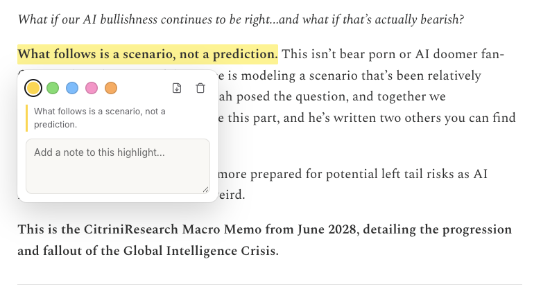
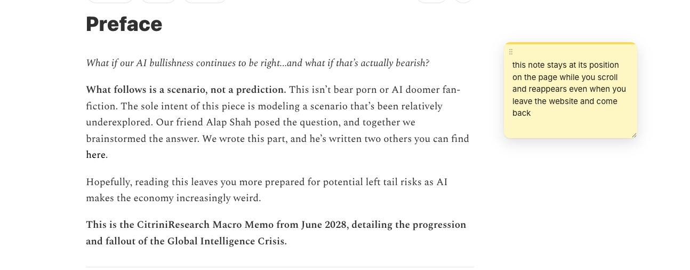
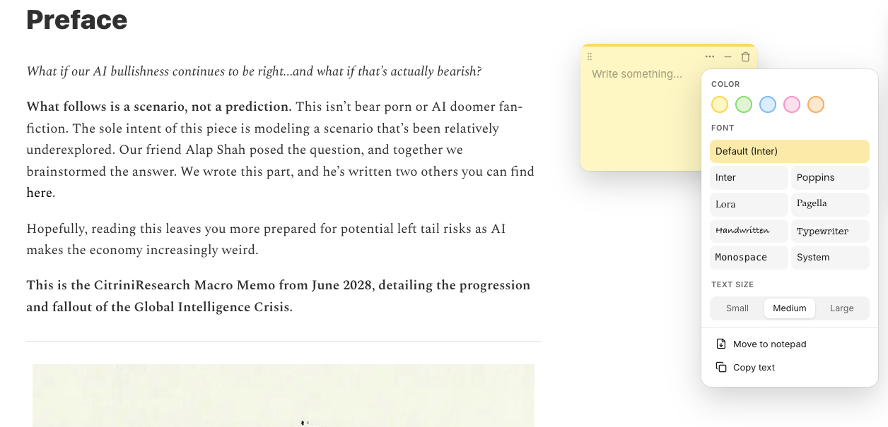
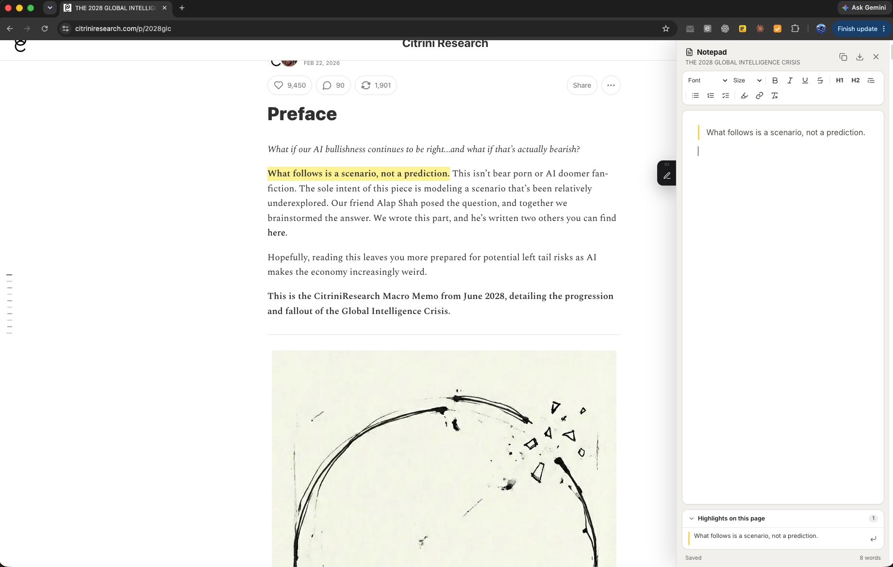
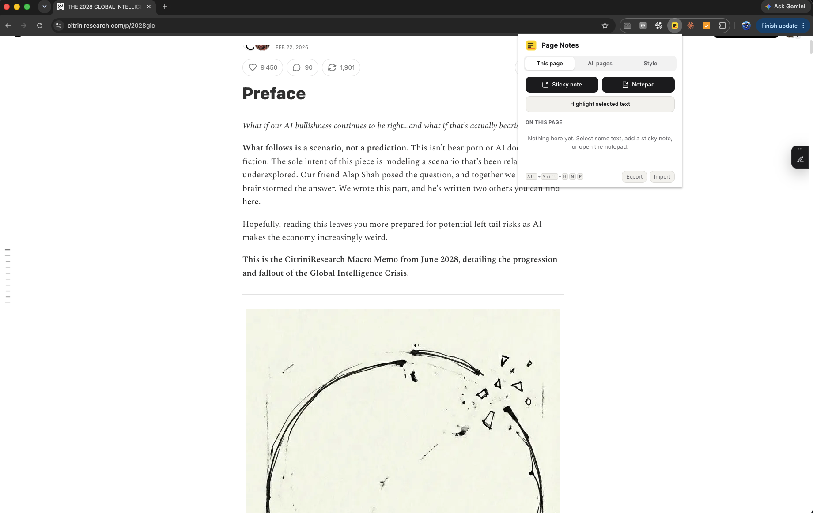
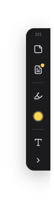

# Page Notes & Highlights

A Chrome extension for highlighting text and leaving notes on any website. Everything is saved automatically per page and restored when you come back.

## Features

- **Highlights.** Select text and highlight it in one of several colors. Auto mode highlights every selection without an extra click.
- **Sticky notes.** Drop draggable, resizable sticky notes anywhere on a page.
- **Notepad.** A per-page side panel with rich text formatting (bold, italic, lists, checklists, quotes, links) for longer notes.
- **Dock.** An optional on-page toolbar for quick access to the tools.
- **Popup.** Browse everything on the current page, search notes across all pages, and adjust font, text size, and colors.
- **Export / import.** Back up all notes and highlights to a JSON file and restore them later.
- **Local storage only.** Data stays in `chrome.storage` on your machine. Nothing is sent anywhere.

## Screenshots

**Highlight text and attach a note to it.** Pick a color, jot a note, or send the highlight to the notepad.



**Sticky notes stay where you put them.** They keep their position while you scroll and reappear when you return to the page.



**Style each note.** Choose a color, one of eight fonts, and a text size. Notes can also be moved into the notepad or copied.



**Notepad panel.** A rich-text side panel per page, with a list of that page's highlights underneath.



**Toolbar popup and dock.** The popup lists everything on the current page and searches across all pages. The dock sits on the edge of the page for one-click access.





## Keyboard shortcuts

| Shortcut | Action |
| --- | --- |
| `Alt+Shift+H` | Highlight the selected text |
| `Alt+Shift+N` | Add a sticky note to the page |
| `Alt+Shift+P` | Open or close the notepad for this page |

The same actions are also available from the right-click context menu. Shortcuts can be changed at `chrome://extensions/shortcuts`.

## Install

1. Clone or download this repository.
2. Open `chrome://extensions` in Chrome.
3. Turn on **Developer mode** in the top-right corner.
4. Click **Load unpacked** and select this folder.

## Project layout

```
manifest.json   Extension manifest (Manifest V3)
background.js   Service worker: context menus and keyboard commands
content.js      Draws highlights, notes, notepad, and dock on every page
content.css     Styles for the on-page UI
shared.js       Colors, fonts, sizes, and default settings shared by all scripts
popup.html/js   The toolbar popup
fonts/          Bundled web fonts (see fonts/LICENSES.txt)
icons/          Extension icons
screenshots/    Images used in this README
```
